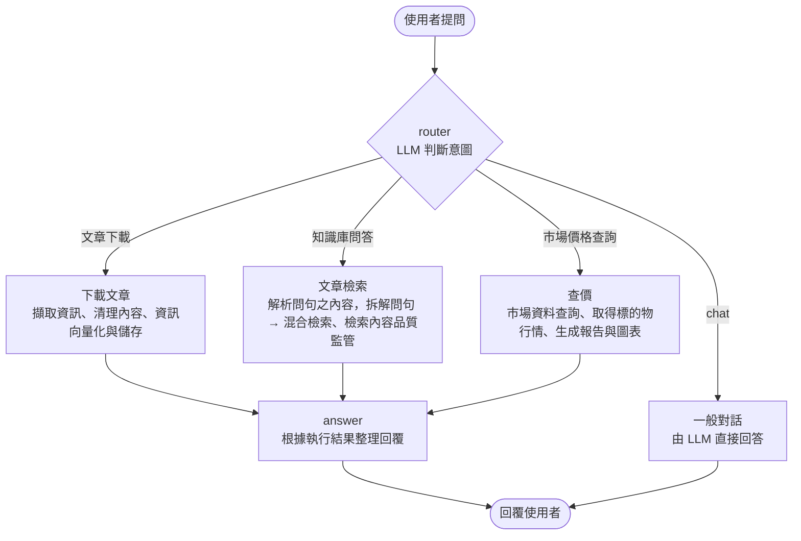

## 1. 專案概述

以 Substack 財經文章為資料來源的閱讀助理，整合文章下載、RAG 問答與市場查價，讓使用者透過聊天介面查找文章內容與相關價格資訊。

專案使用 LangGraph 管理對話流程，依照使用者的需求分流至對應功能，並以 Chainlit 提供操作介面。

## 2. 開發動機

平常會閱讀幾位 Substack 財經作者的文章，看到想留著之後再看的內容，就會先收藏起來。但文章累積之後，常常只記得「好像讀過」，卻忘了是哪一篇。想找回作者對某個主題的看法，就得回到收藏清單一篇篇翻。

透過此專案練習 Agent 和 RAG 的開發，因此選擇自己訂閱的文章作為資料來源，希望把閱讀時遇到的不方便，變成一個可以實際使用的工具。

開發過程中，我也發現真實資料帶來的挑戰：檢索結果不一定符合預期。因此，我建立了檢索評估，檢查不同方法的表現，作為後續調整的依據。

## 3. 主要功能

| 功能 | 輸入範例 / 使用情境 | 處理內容 |
|---|---|---|
| **下載文章** | 「幫我下載 A 作者最新文章」 | 下載文章、清理內容並建立索引，納入文章知識庫。 |
| **文章問答** | 「A 作者 2026 年對 ONDO 的看法？」 | 支援作者與年份篩選，依檢索到的文章段落生成回答。 |
| **市場查價** | 「特斯拉現在股價多少？」<br>「幫我畫 AAPL 過去 90 天的 K 線圖」 | 提供股票與加密貨幣的即時、歷史價格查詢，以及 K 線圖。 |

## 4. Quick Start

```bash
# 安裝依賴
uv sync

# 設定環境變數與作者清單
cp .env.example .env
cp authors.example.json authors.json
```

打開 `authors.json` 設定要下載的作者（這個檔案不會進版控）：

| 欄位 | 用途 |
|---|---|
| `name` | 作者在 Substack 上的名稱，會存進資料庫，作者篩選時用它比對 |
| `aliases` | 提問時可能怎麼稱呼這位作者，讓 LLM 對應到 `name` |
| `profile_user_id` | 作者在 Substack 的數字 ID，下載文章用 |
| `sid_env` | 存放這位作者登入 cookie 的環境變數名稱 |

打開 `.env` 填入：

| 變數 | 用途 |
|---|---|
| `ANTHROPIC_API_KEY` | Claude，負責判斷意圖和產生回答 |
| `APCA-API-KEY-ID`、`APCA-API-SECRET-KEY` | Alpaca，查價用 |
| `SUBSTACK_AUTHOR_A_SID` 等 | Substack 登入 cookie，下載文章用；名稱要和 `authors.json` 的 `sid_env` 一致 |
| `CHROMA_DB_PATH`（選填） | 向量資料庫位置，不填會用 `data/chroma_db` |

```bash
# 跑網頁版
uv run chainlit run app/chainlit_app.py

# 或跑 CLI 版
uv run python app/graph.py

# 跑單元測試（不需要 API）
uv run pytest tests/
```

> **第一次使用時，文章知識庫是空的。** 文章內容有版權，所以向量資料庫沒有放進 repo。
> 請先在聊天介面輸入「幫我下載 A 作者最新文章」，下載文章並建立索引後，才能進行文章問答（需要自己的 Substack 登入 cookie）。

## 5. 架構與技術選型

### 5.1 架構



### 5.2 技術選型

| 技術角色 | 使用工具 | 用途 | 選用考量 |
|---|---|---|---|
| **流程管理** | LangGraph | 管理意圖分流、節點執行與狀態傳遞 | 將文章下載、問答、查價與一般對話拆成明確的處理流程，方便個別測試與維護；搭配 checkpointer 保留對話狀態。 |
| **文件處理與檢索** | LlamaIndex | 處理文章切分、索引建立、檢索與生成評估（尚未執行） | 提供 Markdown 章節切分、metadata 篩選及 reranker 等整合介面，減少自行串接的工作。 |
| **向量儲存** | Chroma | 儲存文章向量與 metadata | 可在本地執行，無須另設伺服器，適合目前約 270 篇文章、3,500 個段落的資料規模。 |
| **語言模型** | Claude、LangChain | 判斷意圖、抽取查詢參數並生成回答 | 透過 LangChain 的結構化輸出介面搭配 Pydantic，定義分流與參數格式，並限制作者欄位的允許值。 |
| **市場資料** | Alpaca API | 取得美股與加密貨幣的價格及歷史行情 | 以同一套介面支援兩類市場資料，方便整合查價與圖表功能；目前不涵蓋台股。 |
| **對話介面** | Chainlit | 提供網頁聊天介面與圖表顯示 | 減少前端開發工作，並可直接在對話中呈現 Plotly 圖表。 |

### 5.3 檢索流程設計

Substack 財經文章以中文為主，內容中也包含英文名稱、股票代號與金融專有名詞。因此，檢索流程結合向量與關鍵字搜尋，再透過重排模型選出提供給 LLM 的段落。

| 階段 | 處理方式 | 目的 | 選用依據 |
|---|---|---|---|
| **文章處理** | 將文章轉為 Markdown，依 Markdown 標題切分，保留章節路徑、作者與日期。 | 保留文章結構，並支援條件篩選。 | — |
| **向量索引** | 使用 `bge-base-zh-v1.5` 產生段落向量，存入 Chroma。 | 建立可供語意搜尋的索引。 | 與 `bge-m3` 比較：放進完整流程後只差 1 題，但 `bge-m3` 建庫時間為 3 倍、記憶體為 5 倍。 |
| **查詢解析** | 從問題中抽取作者、年份等條件。 | 縮小搜尋範圍。 | 作者欄位以 `Literal` 限制允許值，避免 LLM 填出資料庫沒有的名稱；若帶條件查無結果，自動移除條件改查全庫。 |
| **混合檢索** | 結合向量搜尋與 BM25；使用 jieba 與自訂財經詞典斷詞。 | 同時涵蓋語意相似內容與專有名詞。 | 加入 BM25 後，正確文章進入前 10 筆候選的比例由 83% 提升至 100%（見 6.3）。斷詞也比較過轉簡體、外部財經詞庫，皆無改善。 |
| **結果重排** | 使用 `bge-reranker-base` 重排 10 筆候選段落，保留前 3 筆。 | 選出提供給 LLM 的相關內容。 | 原先的英文 reranker 使 Hit@1 由 60% 降至 49%；改用中英雙語模型後提升至 83%。 |
| **回答生成** | 檢查檢索內容品質，再根據相關段落生成回答。 | 讓回答以文章內容為依據。 | 品質檢查每次多呼叫一次 LLM，效果尚未驗證，待生成評估確認是否保留。 |

## 6. 系統評估

系統中有多個由 LLM 判斷的步驟，每一步都可能出錯，因此依問題經過的順序分開評估。目前已完成意圖分流與文章檢索，其餘項目已準備題庫或腳本，尚未執行。

評估腳本放在 `evals/`。Router 與 RAG 的題庫、執行報告含有文章標題與作者資訊，因此沒有公開。

### 6.1 各階段評估

| 評估項目 | 檢查重點 | 評估方式 |
|---|---|---|
| **意圖分流** | 是否進入正確的功能流程。 | 分流正確率、混淆矩陣。 |
| **文章檢索** | 是否找到相關內容，以及排名是否足夠靠前。 | Hit@K、MRR、不同配置的比較。 |
| **參數抽取** | 查價：標的代號、時間範圍、是否畫圖。<br>文章問答：作者、年份。 | 欄位正確率、錯誤類型。 |
| **回答品質** | 是否回答問題、符合來源內容，以及有無加入缺乏依據的敘述。 | 以 LLM 評分（LlamaIndex Faithfulness、Answer Relevancy 等）。 |

回答品質（生成評估）要在檢索評估之後進行：檢索若取錯資料，回答品質的分數便沒有意義。之後調整回答的 prompt、更換 LLM，或決定是否保留「檢索內容品質檢查」這一步時，都需要用它比較前後差異。

### 6.2 Router 意圖分流評估

本項評估檢查 Router 能否根據使用者輸入，選擇正確的處理路線：download、rag、market_price 或 chat。評估範圍僅包含路線選擇，不包含後續參數抽取、工具執行與回答生成。

#### 題庫與計分

| 題型 | 題數 | 計分方式 |
|---|---:|---|
| **核心題** | 27 | 意圖明確，以預先指定的路線作為標準答案，納入正式計分。 |
| **邊界題** | 4 | 可能存在多種合理解讀，另列結果供分析，不納入準確率。 |

#### 評估指標

| 指標 | 定義 | 用途 |
|---|---|---|
| **整體準確率（Accuracy）** | 正確分流題數 ÷ 核心題總數。 | 檢查整體分類表現。 |
| **各路線召回率（Recall）** | 正確分流至該路線的題數 ÷ 標準答案為該路線的題數。 | 檢查特定路線是否容易被漏判。 |
| **混淆矩陣（Confusion Matrix）** | 統計標準路線與實際預測路線的組合及次數。 | 分析哪些路線容易互相混淆。 |

#### 評估結果

| 項目 | 結果 |
|---|---|
| **核心題整體準確率** | 27／27，100%。 |
| **各路線召回率** | 四條路線皆為 100%。 |
| **邊界題預期一致數** | 3／4，另列參考，不納入正式計分。 |

#### 評估限制

- 「我要看 A 作者最新文章提到的那支股票現在的走勢圖」，router 選了 RAG、預期是查價，兩種解讀都合理。
- 以上為單次執行結果。Router 的 temperature 設為 0.7，相同輸入重複執行時，分類結果可能不同，因此本次 100% 的準確率尚不能代表分類穩定性。後續可重複執行相同題庫，觀察準確率與分類結果的一致程度。

### 6.3 RAG 檢索評估

評估檢索與重排能否找到相關文章，不包含前端 LLM 的作者、年份解析，也不評估最終回答品質。

#### 題庫與計分方式

使用 35 題核心題，每題指定一篇應檢索到的文章作為標準答案。

檢索以段落為單位，正確性則依所屬文章判定：只要取回標準文章中的任一段落，即視為命中。計算排名時，先將候選段落依出現順序轉成文章清單（同一篇文章只保留第一次出現的位置），再看正確文章在清單中的名次。

#### 評估指標

| 指標 | 定義 | 例：正確文章排在第 2 名 |
|---|---|---|
| **Hit@1** | 第一筆結果命中正確文章的題數比例。 | 0 |
| **Hit@3** | 前三筆結果中包含正確文章的題數比例。正式流程只提供前三筆給 LLM，因此作為主要指標。 | 1 |
| **Hit@10** | 前十筆候選中包含正確文章的題數比例，用來檢查第一階段是否成功取回相關內容。 | 1 |
| **MRR** | 各題首次命中名次的倒數平均；未命中計為 0，數值越高表示相關內容越靠前。 | 1 ÷ 2 = 0.5 |

#### 評估時機

| 階段 | 評估內容 |
|---|---|
| **第一階段檢索** | 以 Hit@10 檢查正確文章是否進入候選集合。 |
| **Reranker 重排後** | 計算 Hit@1、Hit@3，以及完整 10 筆排名的 MRR。 |
| **回答生成** | 取重排後前三筆作為上下文，不納入本節評分。 |

Reranker 在此流程中只調整候選順序，不改變候選集合。因此，若第一階段未取回正確文章，後續重排也無法補回。

#### 第一階段檢索對照

| 檢索方式 | Hit@1 | Hit@3 | Hit@10 | MRR | 每題耗時 |
|---|---:|---:|---:|---:|---:|
| 向量檢索（`bge-base-zh-v1.5`） | 60% | 77% | 83% | 0.69 | 0.2 秒 |
| BM25（jieba 斷詞） | 71% | 86% | 97% | 0.80 | 0.4 秒 |
| **Hybrid：向量＋BM25，以 RRF 合併** | **74%** | **91%** | **100%** | **0.83** | **0.6 秒** |

RRF（Reciprocal Rank Fusion）依兩份排名的名次合併結果：

$$
\text{RRF}(d) = \sum_{i \in \{\text{向量},\ \text{BM25}\}} \frac{1}{k + \text{rank}_i(d)}, \quad k = 60
$$

- $\text{rank}_i(d)$：段落 $d$ 在第 $i$ 份排名中的名次；沒有出現在該份排名則不計分。
- 只看名次、不看原始分數，因此向量相似度（0～1）與 BM25 分數（無上限）尺度不同也能直接合併。
- 兩份排名都靠前的段落分數最高；$k$ 用來降低第 1 名與後面名次之間的差距。

向量檢索有 6 題未在前十筆取回正確文章，其中多題涉及專有名詞，例如「柯立芝時代的股市表現」與「A 作者對 ONDO 的看法」。改用 Hybrid 後，這 6 題皆進入候選集合，再經 reranker 重排，最終 Hit@1 達到 94%。

此外，也比較過 TF-IDF 與 word2vec；在本次測試設定下，BM25 的 Hit@1 與 MRR 較高，因此選作補充檢索方法。

#### 改善前後對照

比較建立評估前的檢索流程，與經過第 7 節的修正後的流程。兩者都在 reranker 之後計分。

| 配置 | 流程 | Hit@1 | Hit@3 | MRR |
|---|---|---:|---:|---:|
| 改善前 | LLM 解析作者、年份 → 向量檢索 → 英文 reranker | 60% | 71% | 0.65 |
| **改善後** | Hybrid 檢索（向量＋BM25）→ 中文 reranker | **94%** | **100%** | **0.97** |

改善後的數字**不含** LLM 解析作者、年份這一步，含此步驟的完整流程尚未量測。

#### 評估限制

本次題庫僅有 35 題，部分題目用詞與原文接近，可能有利於 BM25。因此，結果尚不足以推論 BM25 在其他問法下也優於向量檢索。

目前保留 Hybrid，兼顧精確詞彙比對與語意檢索；後續需加入更多口語改寫與不同表達方式的題目，驗證其效果。若同一份題庫也用於反覆調整配置，這些數據應視為開發集結果，仍需獨立測試集確認泛化表現。

### 6.4 效能與成本

#### LLM 呼叫次數

每次提問依路線不同，會呼叫 2–4 次 LLM（Claude Sonnet）：

| 路線 | 呼叫次數 | 用途 |
|---|---:|---|
| 文章問答 | 4 | 意圖分流、解析作者與年份、檢查檢索內容品質、生成回答 |
| 下載文章 | 3 | 意圖分流、判斷下載的作者、生成回答 |
| 市場查價 | 3 | 意圖分流、抽取查詢參數、生成回答 |
| 一般對話 | 2 | 意圖分流、直接回答 |

#### 回應時間與資源

| 項目 | 數值 | 說明 |
|---|---|---|
| 文章問答每題耗時 | 約 18 秒（2 核 CPU） | 混合檢索本身約 0.6–1.5 秒，大部分時間花在 reranker 計算 10 筆候選 |
| 本地模型記憶體 | 約 1.5 GB | embedding 模型與 reranker 在本機執行，不需 API 費用 |

#### 尚未量測

- 每次提問的 token 用量與費用。

## 7. Challenge

### 問題定位與改進過程

| 步驟 | 發現與處理 | 結果 |
|---|---|---|
| **檢查實際配置** | 原先使用的 reranker 為 `cross-encoder/ms-marco-MiniLM-L-6-v2`，以英文資料訓練，用在中文文章反而降低排序表現，後續改用支援中文的 `BAAI/bge-reranker-base`。另外發現原先設定未實際啟用混合檢索，以及作者名稱與 metadata 不一致。 | 修正配置與替換 reranker 後，Hit@1 提升至 83%。 |
| **補強關鍵字檢索** | 加入 BM25，補強專有名詞與交易代號的比對。 | 搭配 reranker 後，Hit@1 達 94%、Hit@3 達 100%。 |

## 8. 已知限制

### 功能範圍

- 只支援特定作者；新增作者需要該作者的登入 cookie，並同步更新作者欄位的允許值。
- 登入 cookie 會過期，過期後下載會失敗（會回報錯誤原因）。
- 查價只支援美股和加密貨幣。
- 圖表只有網頁版會顯示。
- 對話記憶存在記憶體裡，程式重啟就會清空。
