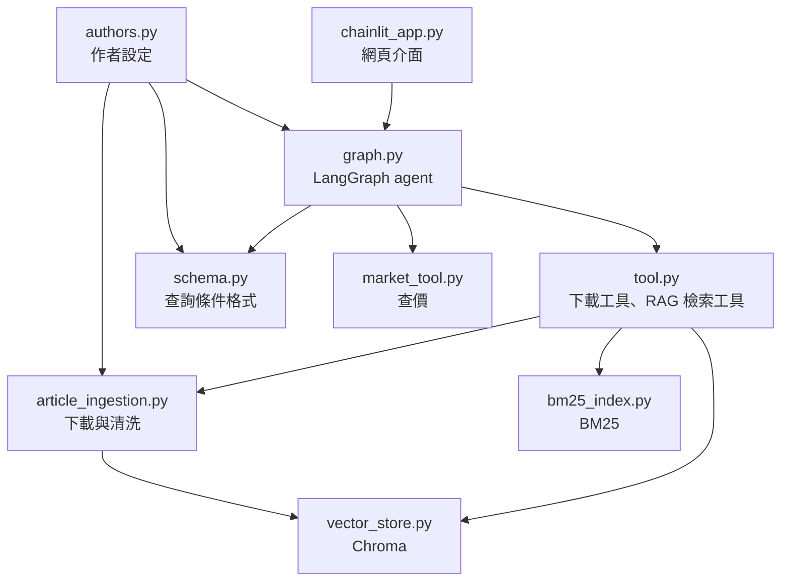

# app/ 程式架構說明

這個資料夾是專案的正式程式碼。本文件說明每個檔案負責什麼、裡面有哪些主要的類別與函式，方便快速找到要看的地方。

整體流程與評估結果請見專案根目錄的 [README](../README.md)。

## 檔案總覽

| 檔案 | 負責什麼 | 屬於哪條路線 |
|---|---|---|
| [`chainlit_app.py`](chainlit_app.py) | 網頁聊天介面的入口 | 介面 |
| [`graph.py`](graph.py) | LangGraph agent：意圖分流、各功能節點、組裝整張流程圖 | 全部 |
| [`authors.py`](authors.py) | 讀取作者設定檔（`authors.json`） | 下載、問答 |
| [`tool.py`](tool.py) | 下載文章工具、RAG 檢索工具（hybrid 檢索 + reranker） | 下載、問答 |
| [`article_ingestion.py`](article_ingestion.py) | 從 Substack 下載文章、清洗成 Markdown、切分段落 | 下載 |
| [`vector_store.py`](vector_store.py) | Chroma 向量資料庫的連線與寫入 | 下載、問答 |
| [`bm25_index.py`](bm25_index.py) | BM25 關鍵字索引、jieba 中文斷詞、metadata 篩選 | 問答 |
| [`schema.py`](schema.py) | 文章問答的查詢條件格式（作者、日期等 filter） | 問答 |
| [`market_tool.py`](market_tool.py) | 查詢 Alpaca 市場價格、產生報告與 K 線圖 | 查價 |
| `bm25_userdict.txt` | jieba 自訂詞典：財經術語 | 問答 |
| `bm25_userdict_tw.txt` | jieba 自訂詞典：台灣用字（例如「台灣」而不是「臺灣」） | 問答 |
| `jieba_dict.txt.big` | jieba 官方繁體大詞典 | 問答 |

## 模組之間的關係

箭頭表示「呼叫／匯入」。

## 各檔案內容

### chainlit_app.py：網頁介面入口

用 `uv run chainlit run app/chainlit_app.py` 啟動。

| 名稱 | 說明 |
|---|---|
| `start()` | 開啟聊天視窗時送出歡迎訊息 |
| `main(message)` | 收到使用者訊息時呼叫 agent，回傳文字回答；查價有圖表時一併附上 |
| `extract_chart_figure(result)` | 從 agent 的結果取出查價的 Plotly 圖表，沒有就回傳 `None` |

每個瀏覽器 session 的 `thread_id` 直接當作 LangGraph 的 `thread_id`，所以同一個分頁內的對話有記憶，不同分頁互不干擾。

### graph.py：LangGraph agent

整個 agent 的流程都在這裡。也可以用 `uv run python app/graph.py` 在終端機對話。

**State（在節點之間傳遞的資料）**

| 名稱 | 說明 |
|---|---|
| `AgentState` | 整張圖共用的 state：`messages`（對話紀錄）、`router`（這一輪走哪條路）、`tool_result`（工具結果） |
| `ToolResult` | 下載、檢索、查價三條路的結果都寫成這個固定格式：`source`、`success`、`summary`、`raw`、`error`、`meta` |

**節點**

| 節點 | 函式 | 說明 |
|---|---|---|
| `router` | `router_node()` | 用 LLM 判斷意圖，分到 `download`、`rag`、`market_price`、`chat` 其中一條；每輪會清空上一輪的 `tool_result` |
| `download article` | `download_node()` | 用 LLM 判斷要下載哪位作者，呼叫下載工具 |
| `retrieve` | `rag_search_node()` | 拆解作者、年份條件 → 呼叫檢索工具 → 用 LLM 檢查檢索結果品質 |
| `market price` | `market_price_node()` | 呼叫查價工具 |
| `answer` | `answer_node()` | 讀取 `tool_result`，產生最終回答 |
| `chat` | `chat_node()` | 不需要外部資料，直接由 LLM 回答 |

**其他**

| 名稱 | 說明 |
|---|---|
| `RouteDecision`、`DownLoad_Author`、`Judge_RAG_answer` | LLM 結構化輸出的格式（分流結果、要下載的作者、品質檢查結果） |
| `from_router()` | conditional edge：依 `state["router"]` 決定下一個節點 |
| `agent` | 編譯好的 graph，搭配 `MemorySaver` 保存對話記憶 |
| `configure_logging()` | 統一設定 log 格式，只在程式入口呼叫 |
| `run_chat_loop()` | 終端機對話模式 |

### authors.py：作者設定

從 JSON 設定檔讀取作者清單，程式碼裡不寫死作者名稱。讀取順序：環境變數 `AUTHORS_CONFIG` → 專案根目錄的 `authors.json` → `authors.example.json`。

| 名稱 | 說明 |
|---|---|
| `AUTHORS` | 設定檔內容：每位作者的 `name`、`aliases`、`profile_user_id`、`sid_env` |
| `AUTHOR_NAMES` | 所有作者的 `name` |
| `AuthorName` | 由 `AUTHOR_NAMES` 產生的 `Literal`，限制 LLM 只能填設定檔裡有的作者 |
| `author_prompt_hint()` | 產生給 prompt 用的作者對照說明（名稱與別名） |
| `get_author(name)` | 依名稱取得一位作者的設定 |

### tool.py：下載工具與 RAG 檢索工具

兩個對外的工具都回傳固定格式 `{"success", "data", "error"}`，不會把例外丟給呼叫端。

| 名稱 | 說明 |
|---|---|
| `download_substack_article(author_name)` | LangChain tool：下載指定作者的最新文章並寫入向量資料庫 |
| `retrieve_nodes(user_query, filtered_query, final_filters)` | LangChain tool：hybrid 檢索 → reranker，回傳前 3 筆段落；帶條件查無結果時，自動移除條件改查全庫 |
| `hybrid_search()` | 向量檢索與 BM25 各取 10 筆，用 RRF 合併 |
| `fuse_rrf()` | RRF 合併：每筆分數為 Σ 1 / (60 + 名次) |
| `_get_reranker()` | 載入 `BAAI/bge-reranker-base`，只載入一次 |
| `FIRST_STAGE_TOP_K`、`RRF_K`、`RERANK_MODEL`、`RERANK_TOP_N` | 檢索參數：第一階段筆數 10、RRF 常數 60、reranker 模型、最後保留 3 筆 |

### article_ingestion.py：文章下載與清洗

| 名稱 | 說明 |
|---|---|
| `AUTHOR_MAP` | 由 `authors.py` 產生：每位作者的 Substack ID 與登入 cookie |
| `ArticleIngestionPipeline` | 下載到切段的完整流程 |
| `.download_and_process()` | 主入口：下載 → 轉 Markdown → 切段 → 寫入資料庫 |
| `.down_load_article()` | 呼叫 Substack API，取得最新文章的 HTML 與資訊（標題、日期、作者） |
| `.markdown_content()` | HTML 清洗並轉成 Markdown |
| `.article_parser()` | 用 `MarkdownNodeParser` 依標題切成段落，移除圖片連結 |
| `convert_to_timestamp()` | 日期字串轉成時間戳記，供日期篩選使用 |

### vector_store.py：Chroma 向量資料庫

| 名稱 | 說明 |
|---|---|
| `DB_PATH` | 資料庫位置，預設 `data/chroma_db`，可用環境變數 `CHROMA_DB_PATH` 覆蓋 |
| `EMBED_MODEL` | Embedding 模型 `BAAI/bge-base-zh-v1.5` |
| `VectorStoreService` | 資料庫的連線與操作 |
| `.vector_store()` | 取得 LlamaIndex 的 `ChromaVectorStore` |
| `.save_nodes_to_vector(nodes, article_info)` | 寫入段落；同一篇文章已存在時不重複寫入 |

### bm25_index.py：BM25 關鍵字索引

| 名稱 | 說明 |
|---|---|
| `tokenize(text)` | 轉小寫 → jieba 斷詞（繁體大詞典 + 自訂詞典）→ 去停用詞與標點；建索引和查詢共用 |
| `BM25Index` | 從 Chroma 讀出所有段落建立 BM25 索引 |
| `.search(query, top_k, filters)` | 關鍵字檢索，並套用和向量檢索相同的作者、日期篩選 |
| `get_bm25_index(vector_store)` | 取得索引；資料庫段落數變動（有新文章）時自動重建 |
| `matches_filters()` | 判斷一筆段落的 metadata 是否符合篩選條件 |

### schema.py：查詢條件格式

LLM 用這裡的格式把問題拆成「篩選條件 + 搜尋關鍵字」。

| 名稱 | 說明 |
|---|---|
| `SearchIntentPayload` | LLM 的輸出格式：`query`（搜尋關鍵字）、`author`（作者，限定 `AuthorName`）、`filters`（日期等條件）、`condition`（AND / OR） |
| `.to_llama_index_filters` | 轉成 LlamaIndex 的 `MetadataFilters`；日期字串會轉成時間戳記 |
| `Metadata_Filter` | 單一條件：欄位、運算子、值 |

### market_tool.py：查價

| 名稱 | 說明 |
|---|---|
| `market_price_check(query)` | LangChain tool：查價主入口，回傳 `{"success", "data", "error"}` |
| `extract_query_params(query)` | 用 LLM 把問題轉成查詢參數；獨立成函式，方便單獨評估 |
| `AlpacaQueryParams` | 查詢參數格式：類別（股票／加密貨幣）、代號、即時／歷史、日期區間、是否畫圖 |
| `fetch_alpaca_data(params)` | 呼叫 Alpaca API |
| `generate_market_report()` | 把價格資料整理成文字報告 |
| `plot_candlestick()` | 用 Plotly 畫 K 線圖 |

## 想找什麼，看哪裡

| 想了解 | 看這裡 |
|---|---|
| 問題怎麼被分到不同功能 | `graph.py` 的 `router_node()` |
| 整張流程圖怎麼接起來 | `graph.py` 最下方的 `agent_graph` |
| 檢索流程、RRF、reranker | `tool.py` 的 `retrieve_nodes()`、`hybrid_search()` |
| 中文斷詞怎麼做 | `bm25_index.py` 的 `tokenize()` |
| 作者、年份篩選怎麼產生 | `schema.py` 的 `SearchIntentPayload` |
| 新增一位作者 | 專案根目錄的 `authors.json`，以及 `.env` 的登入 cookie |
| 文章怎麼切段 | `article_ingestion.py` 的 `article_parser()` |
| 修改 embedding 模型、資料庫位置 | `vector_store.py` 開頭的設定 |
| 查價參數怎麼解析 | `market_tool.py` 的 `AlpacaQueryParams`、`extract_query_params()` |
